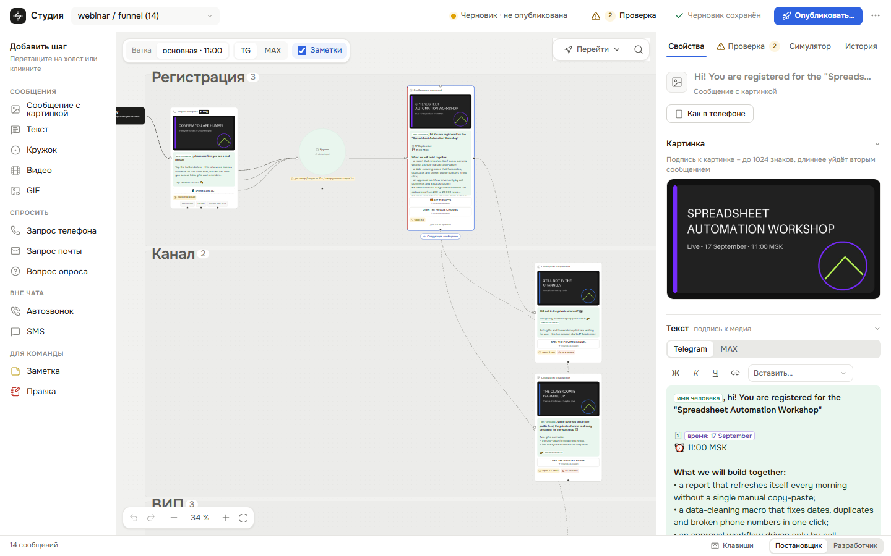
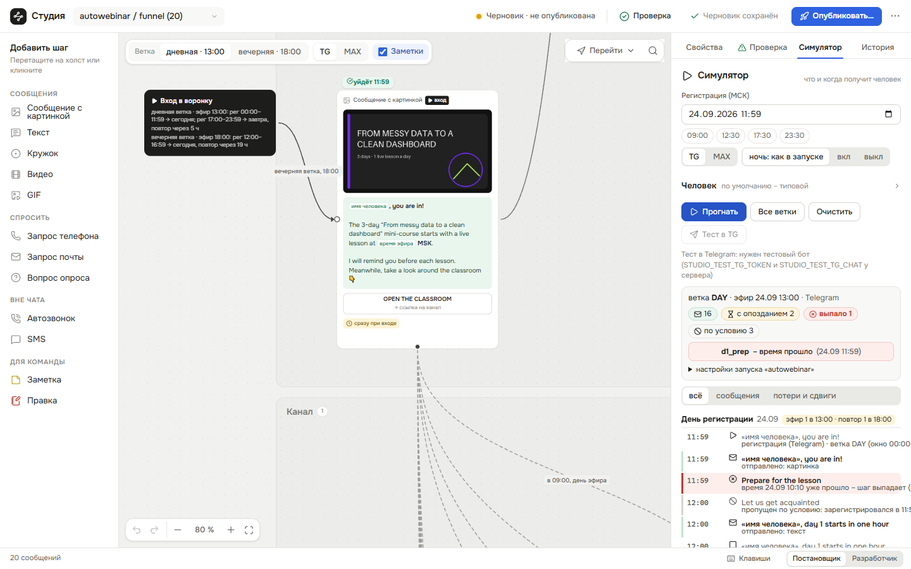
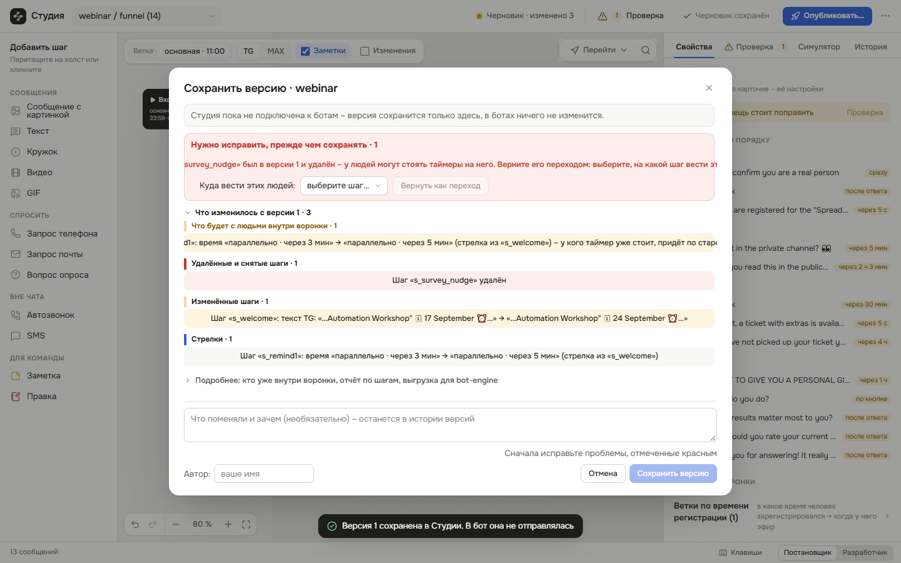
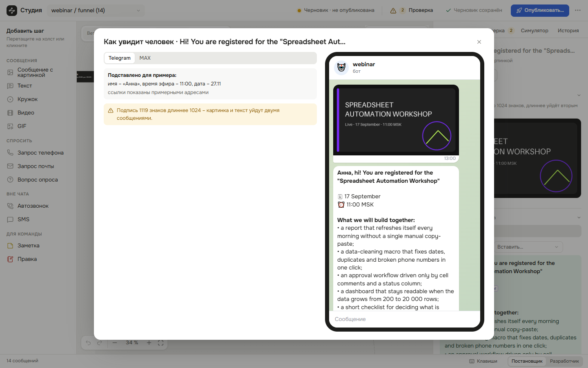
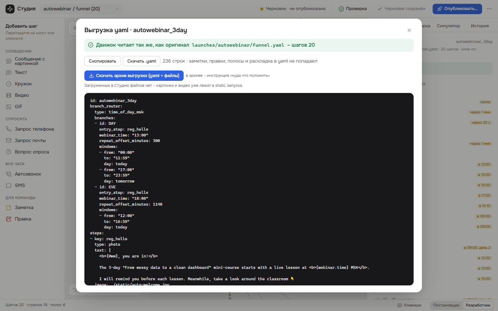

<h1 align="center">Funnel Studio</h1>
<p align="center">A visual editor for chat-bot funnels (Telegram and MAX) with its own engine that runs them &mdash; for people who plan funnels and developers who ship them.</p>
<p align="center">
  
  
  
  
  
</p>
<p align="center"></p>

> The interface is in Russian (it was built for a Russian-speaking team); the demo funnels in this repository are in English.

## What it does

- **Canvas editor.** Build and edit a funnel with the mouse, then export the yaml that a bot engine reads. The Studio only *reads* the engine's repository and never writes to it.
- **Versions.** One draft plus immutable published versions, a "was / now" diff written in the words of the step cards, and rollback.
- **Simulator.** Pick a registration moment and see what a person gets and when: which branch they fall into, which steps are skipped or dropped, per day, on the canvas. A test run can also send the sequence to a real test bot.
- **Simple mode and developer mode.** Simple mode hides keys, HTML and advanced fields and shows a "how it looks on a phone" preview for Telegram and MAX; developer mode shows everything.
- **Its own engine** (`runtime/`). A published funnel starts working in Telegram and MAX with no image rebuild and no restart; timers live in Postgres, and people already inside a funnel are not lost when a new version goes out.
- **Import from Miro.** A frame link becomes a funnel with its pictures; re-importing the board shows a "was / now" diff and does not erase manual edits.
- **Bots section.** Add a bot by token and edit its name, descriptions, avatar and commands from the Studio; tokens are stored encrypted.

## Why it's interesting

- **A round trip as the correctness oracle.** `yaml -> graph -> yaml` is checked against the engine's own loader: `load_funnel(original)` and `load_funnel(after the round trip)` must dump to the same model, and a second pass must be byte-for-byte idempotent (step ids are deterministic `uuid5`). It runs over every funnel in the demo repository, and a mapping test fails as soon as the engine gets a field the Studio's model has no place for.
- **Versions you can reason about.** Published versions are immutable (SQLite triggers forbid edits, one published version per funnel). The diff is computed server-side by step id, not key, in human words; python and TypeScript share one golden phrase file so the two implementations cannot drift apart. Publishing is blocked when a step that people are waiting on disappears without a tombstone.
- **A simulator that follows the engine's rules, not the picture.** Rules such as "two chain steps at the same minute: the second one is dropped", `skip_if_past`, night mode, claim buttons cancelling timers and per-branch offsets are reproduced from the engine and pinned by tests, so the lost-message cases show up before launch.
- **An engine you can deploy into without a restart.** Jobs are claimed with `FOR UPDATE SKIP LOCKED` and a lease; `NOTIFY` hot-swaps a new funnel version into the running worker. The tests run on a real Postgres with a fake Telegram, a fake MAX API and a controllable clock.
- **Secrets stay server-side.** Bot tokens are encrypted with Fernet (`cryptography`); the browser only ever sees the last four characters, and the tests assert that a token shows up in no API response and no log line.

## Tech stack

| Layer | Tools |
|---|---|
| Backend | Python 3.12, FastAPI, pydantic v2, SQLite (drafts and versions), uv |
| Frontend | React 19, TypeScript, Vite, React Flow (`@xyflow/react`), elkjs layout, zustand |
| Engine | aiogram 3.13 (Telegram), an aiohttp client for the MAX API, asyncpg, PostgreSQL 16 (queue, timers, versions) |
| Integrations | Miro REST API (read-only), optional Claude API for ambiguous sticky notes |
| Tests | pytest + pytest-asyncio, vitest, Playwright scenarios against a real Chrome |

## Screenshots

**Simulator** &mdash; a 3-day evergreen webinar, registration at 11:59: the branch, what is sent and when, a step that drops out because its time has already passed.



**Versions** &mdash; the save dialog: a deleted step must be brought back as a transition (a tombstone) before saving, because people may have timers on it.



**Phone preview** &mdash; the same step as a person sees it, with placeholders filled in and a warning that the caption is longer than Telegram allows.



**Export** &mdash; the engine reads the exported yaml exactly like the original.



## Quick start

You need [uv](https://docs.astral.sh/uv/) (it installs Python 3.12 for you) and Node.js 20.19+ or 22+.

```bash
uv sync
cd web && npm ci && npm run build && cd ..
uv run python -m studio.server          # http://127.0.0.1:8765
```

The Studio opens on the bundled **demo bot repository** (`demo/botrepo`: three fictional launches, five funnels, generated pictures and stub video circles). On the empty screen press the "New funnel or import" button (Russian: «Новая воронка или импорт») and pick a funnel from the list. Drafts, versions and media are kept in `data/` (change with `--data` or `STUDIO_DATA`); to read your own launches point `BOT_REPO_PATH` at a folder with `launches/<slug>/launch.yaml` and `funnel*.yaml`.

The engine (`runtime/`) additionally needs Postgres: see [docs/runtime.md](docs/runtime.md), or `docker compose -f deploy/compose.yaml --env-file deploy/.env up -d --build` after `cp deploy/.env.example deploy/.env`.

## Project structure

```
studio/        FastAPI server: storage, yaml <-> graph converter, versions, simulator, Miro, bots
  convert/       yaml <-> graph (one mapping table for both directions)
  engine_ref/    the engine's funnel model copied as an oracle, plus a drift check
  versions/      SQLite store, semantic diff, publish checks, shared phrase golden file
  sim/           schedule simulator and test run
  miro/          read-only Miro client, board dialects, sticky-note parsers, re-import merge
  bots/          Bot API client, encrypted token vault
web/           canvas and UI (React, TypeScript, Vite) with vitest tests and Playwright scenarios
runtime/       the funnel engine: Postgres queue and timers, Telegram and MAX, step types, gates
demo/botrepo/  fictional launches the Studio reads (generated pictures, stub media)
schema/        JSON Schema of the graph model
deploy/        Docker Compose for Postgres + engine + Studio
tests/         pytest: round trip, server, versions, simulator, Miro, bots, engine (on real Postgres)
docs/          deep dives (Russian): editor, versions, simulator, engine, Miro, bots
```

## Tests & quality

```bash
uv run pytest        # 251 passed, 1 skipped with a local Postgres 16; without Postgres the engine tests skip (146 passed, 106 skipped)
cd web && npm test   # 115 vitest tests: editor operations, validation, lanes, previews, version diffs
cd web && npm run e2e   # Playwright scenarios against a running server and a local Chrome (also e2e:versions, :sim, :publish, :miro, :bots)
```

The engine tests expect Postgres at `127.0.0.1:55432` (user `fs`, password `fsruntime`) or at `STUDIO_TEST_DSN`; the one-line `docker run` is in [docs/runtime.md](docs/runtime.md). All six browser scenarios (`e2e`, `e2e:versions`, `e2e:sim`, `e2e:publish`, `e2e:miro`, `e2e:bots`) passed on this tree. `web/scripts/capture_screenshots.mjs` regenerates the screenshots above.

## Status & roadmap

- **Done:** model and converter, editor, versions, simulator, simple mode, the engine for Telegram and MAX, Miro import, Bots section, Docker deployment.
- **Known gap:** the Miro frame "by days" dialect (`studio/miro/rows.py`) has no test fixture in this public copy, because the original boards belonged to a customer; the "launch" dialect is covered by a fictional board.
- **Not built yet:** attaching a Studio-stored bot to an engine launch from the UI, and embedding the Studio into the engine it was written alongside.
- **Public copy:** the demo funnels, pictures and the Miro board are invented; a few modules are vendored from the engine the Studio targets and keep their original comments.


## License

MIT. See [LICENSE](LICENSE).

---
Built by [Nikita Lapa](https://github.com/nikito4kv) · built with an AI-assisted workflow
